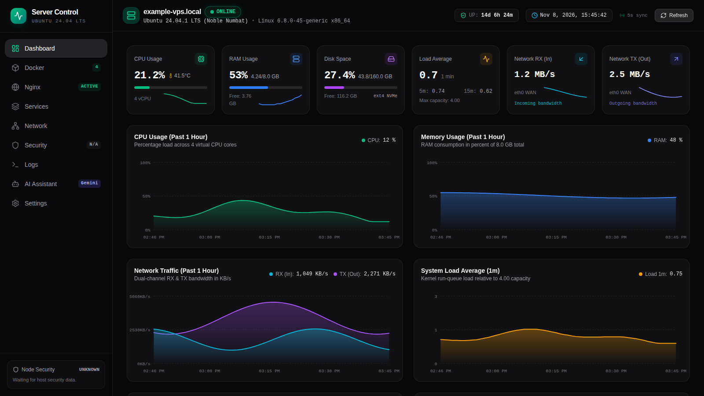

# Server Control Center

[](https://github.com/efimwwz/server-control-center/actions/workflows/ci.yml)
[](https://github.com/efimwwz/server-control-center/releases)
[](LICENSE)
[](https://github.com/efimwwz/server-control-center/stargazers)

**Your Linux server. One clear dashboard.**

Server Control Center (SCC) is a self-hosted monitoring dashboard for Ubuntu servers. It brings system health, Docker, Nginx, network information, systemd services, logs and read-only security checks into one web interface.

[English](README.md) · [Русский](README.ru.md) · [Installation guide](INSTALL.md)

## Dashboard preview



<sub>Captured from the actual SCC frontend using synthetic mock telemetry. No live host metrics or private server details are included.</sub>

## What you can monitor

| Area | What SCC shows |
|---|---|
| **System** | CPU, memory, disk usage, load average, uptime and network throughput |
| **Docker** | Containers, images, published ports, CPU/RAM usage and restart counts |
| **Nginx** | Service state, active connections, request counters, virtual hosts and request history |
| **Services** | systemd service state, PID, memory use and uptime |
| **Network** | Interfaces, routes, gateway, DNS, public IPv4, latency and packet loss |
| **Logs** | Recent selected Nginx, Docker and systemd events |
| **Security** | Read-only checks for firewall, SSH, Fail2ban and SCC service configuration |
| **AI assistant** | Optional server diagnostics with Google Gemini; a local diagnostic fallback is available without an API key |

## Why SCC

- **Self-hosted:** your dashboard runs on infrastructure you control.
- **Private by default:** the web interface is bound to `127.0.0.1:3000`; it is not published on a public network interface by the installer.
- **Separated privileges:** the dashboard container runs unprivileged and does not mount the Docker socket. A separate host-agent reads host telemetry through a local Unix socket.
- **Read-only monitoring:** SCC observes server state; it does not manage containers, edit firewall rules or change SSH/Nginx configuration.
- **Simple deployment:** a release image is pulled from GHCR. Node.js and npm are not required on the target server.

## Preview the interface locally

You can run the dashboard with synthetic demonstration data without connecting it to a real host:

Requirements: Node.js 22 and npm.

```bash
git clone https://github.com/efimwwz/server-control-center.git
cd server-control-center
npm ci
METRICS_PROVIDER=mock npm run dev
```

Open [http://localhost:3000](http://localhost:3000). Mock mode uses synthetic data; it is intended for local preview and development, not production monitoring.

## Install on a server

**Supported target:** Ubuntu Server 24.04 LTS, `amd64` or `arm64`, with systemd.

Read the [installation guide](INSTALL.md) before running the installer. It explains prerequisites, what the installer changes, SSH tunnelling, authenticated HTTPS reverse proxies, troubleshooting and uninstall/rollback behaviour.

```bash
curl -fsSL https://raw.githubusercontent.com/efimwwz/server-control-center/main/install.sh | sudo bash
```

The installer checks the target OS and existing resources, verifies the downloaded release archive with SHA-256, and then installs the matching application and host-agent. It refuses unsupported operating systems and conflicting existing SCC resources.

| Operating system | Status |
|---|---|
| Ubuntu 24.04 LTS Server, `amd64` / `arm64` | **Supported** |
| Ubuntu 22.04 / 26.04 and other Ubuntu releases | Not currently supported or tested |
| Debian 12 / 13 and derivatives | Not currently supported; installer adaptation and testing are required |
| Fedora, Rocky Linux, AlmaLinux, RHEL, openSUSE, Alpine | Not supported by the current installer |
| Windows / Windows Server / macOS | Not supported as a full SCC host; the host-agent is Linux-specific |

Do not bypass the OS check or run the internal installer on an unsupported distribution.

## Security and privacy

SCC is a monitoring dashboard, not a remote administration or authentication system.

- The dashboard container runs as an unprivileged user and has no Docker socket mount.
- The host-agent runs as root because it reads host-level metrics. It exposes fixed read-only GET endpoints over a local Unix socket; POST requests are rejected.
- The installer binds the web dashboard to `127.0.0.1:3000`.
- **There is no built-in login screen.** For remote access, use an SSH tunnel or an authenticated HTTPS reverse proxy. Never expose port `3000` directly to the internet.
- The host-agent checks external connectivity and public IPv4 using external services documented in the installation guide.
- When Gemini is configured and used, the user's question, selected telemetry and part of recent logs are sent to Google. Logs can contain hostnames, IP addresses, URLs and other operational details. Review the data-handling section of the installation guide before enabling AI.

See [SECURITY.md](SECURITY.md) for vulnerability reporting.

## What SCC does not do

SCC does not start, stop or remove containers; change firewall, SSH or Nginx settings; automatically repair a server; or scan for malware and vulnerabilities. Security information is a set of basic read-only checks, not a security certification.

## Documentation

- [Installation guide (English)](INSTALL.md)
- [Руководство по установке (русский)](INSTALL.ru.md)
- [Russian README](README.ru.md)
- [Changelog](CHANGELOG.md)
- [Contributing](CONTRIBUTING.md)
- [Security policy](SECURITY.md)
- [Public launch checklist](docs/PUBLIC_LAUNCH_CHECKLIST.md)
- [Public announcement drafts](docs/ANNOUNCEMENT_DRAFTS.md)

## Contributing and feedback

Bug reports, focused feature proposals, documentation fixes and pull requests are welcome. Please read [CONTRIBUTING.md](CONTRIBUTING.md) first. For bugs, use the repository's issue templates and include reproducible steps without secrets or private server data.

SCC is released under the [MIT License](LICENSE).
